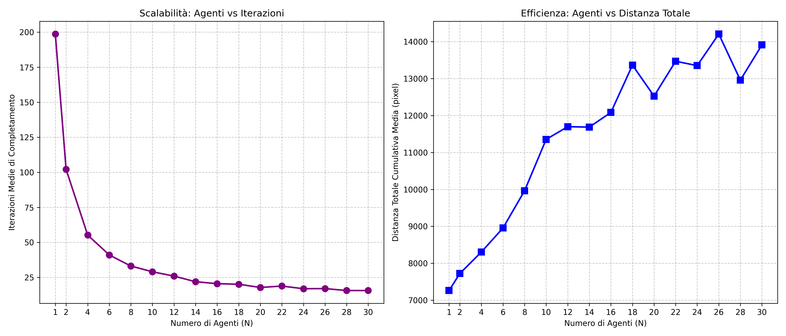
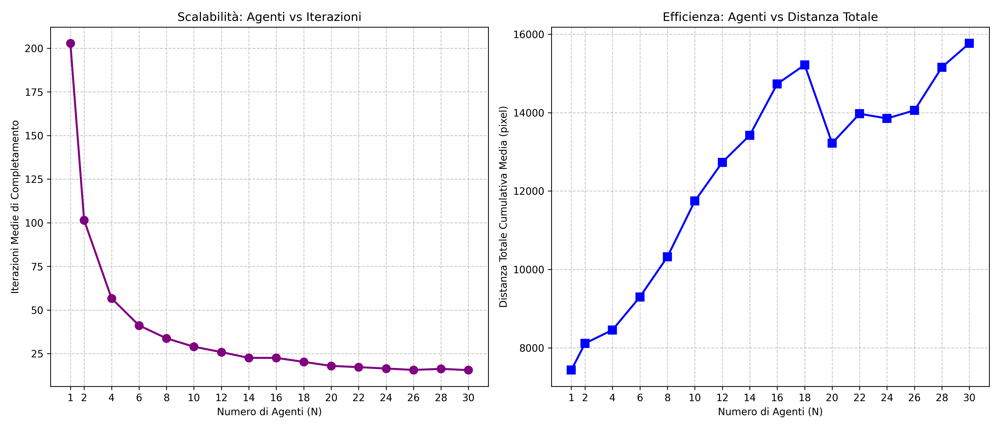

**ESPLORAZIONE MULTI-AGENTE DI UN AMBIENTE 2D UTILIZZANDO CELLE DI VORONOI**
-
L'obiettivo del progetto è definire una simulazione multi-agente in cui più robot esplorano uno spazio sconosciuto, aggiornando una mappa condivisa. Ad ogni iterazione, finché l'intera mappa non risulta esplorata:
1) Vengono calcolate le celle di Voronoi per ogni agente.
2) Ogni agente conduce un’esplorazione all’interno della propria cella: il goal viene impostato come il punto di frontiera più vicino all'agente, mentre per il path planning viene implementata una logica RRT.

Per prevenire situazioni di stallo e garantire il corretto partizionamento dello spazio, qualora un agente non disponga di punti di frontiera all'interno della propria cella, il sistema imposta come sub-goal il punto sul confine della cella geometricamente più vicino al punto di frontiera globale più vicino.
Il sistema implementa inoltre logiche di sicurezza per evitare collisioni con gli ostacoli e con gli altri agenti, impedendo che ciascun agente fuoriesca dalla propria cella di competenza durante la navigazione.

**Assunzioni**
-
Gli agenti sono considerati puntiformi, dotati di percezione perfetta a 360° e caratterizzati da una precisione di movimento ideale.
Gli agenti vengono posizionati inizialmente al centro della mappa con una leggera variazione casuale reciproca. Viene inoltre verificato preventivamente che la posizione iniziale di ciascun agente si trovi su uno spazio libero da ostacoli.

**Architettura del Sistema**
-
L'ambiente è modellato come una griglia bidimensionale discreta di dimensioni 500×500 pixel, in cui ogni elemento è codificato tramite una matrice BGR (poiché OpenCV utilizza questo formato anziché RGB): lo spazio esplorato e libero è rappresentato in bianco ([255, 255, 255]), gli ostacoli fissi in nero ([0, 0, 0]) e le aree inesplorate in grigio ([127, 127, 127]).
La mappa è gestita tramite la classe GridWorld, che supporta sia la configurazione fissa originale che una modalità di generazione casuale (impostando l'attributo random_world=True). Quest'ultima posiziona in modo procedurale ostacoli rettangolari e circolari garantendo il rispetto di margini minimi e lasciando libero il centro della mappa. L'uso delle mappe casualo è stato utilizzato nei test sperimentali per eliminare bias legati a un unico layout fisso e garantire una solida validità statistica. 
Viene inizializzata una mappa interamente grigia (shared_map), aggiornata dinamicamente dagli agenti durante l'esplorazione. La classe include il metodo final_check, che verifica il completamento della copertura controllando lo stato dei pixel.

La classe Agent modella i singoli robot, inizializzati con posizione e raggio del sensore, e contiene gli attributi per l'albero di esplorazione, il percorso selezionato e la voronoi_mask associata per l'iterazione corrente. I metodi principali di questa classe sono:
- scan_world: per l'aggiornamento della percezione.
- move: per la gestione dello spostamento elementare.
- move_to_goal: per seguire un percorso strutturato a nodi fino al goal attivo.
- step_to_goal: per il calcolo dei nodi intermedi nella costruzione dell'albero RRT.
- path_to_goal: per la ricostruzione a ritroso del percorso sull'albero RRT.
- find_goal: per la selezione dell'obiettivo di esplorazione.

Le funzioni di supporto alla pianificazione comprendono:
- compute_voronoi: calcola le celle di Voronoi globali associando ciascun pixel all'agente più vicino.
- planned_exploration: gestisce la pianificazione di movimento per singolo agente. Invoca find_goal e, se l'obiettivo è molto vicino, salta l'RRT validando il percorso tramite collision_check e muovendosi direttamente con move_to_goal. In caso contrario, utilizza l'algoritmo RRT (impostando una volta su dieci il goal come il punto di campionamento casuale, per guidare la crescita dell'albero verso il goal) l’algoritmo RRT è implementato usando le funzioni di supporto find_closest_node (trova il nodo dell’albero più vicino al punto campionato) e step_to_goal (calcola il nuovo nodo da aggiungere all’albero sul segmento nodo albero più vicino - punto campionato). Se l'RRT fallisce, il goal attivo viene azzerato.
- run_simulation: coordina l'intera simulazione iterativa calcolando le celle di Voronoi, eseguendo la pianificazione per ciascun agente, estraendo le frontiere e chiamando la funzione che gestisce il rendering grafico della scena, render_scene.

**Gestione dello stallo**
Durante la pianificazione con l'algoritmo RRT nella propria cella di Voronoi, possono verificarsi dei fallimenti (ad esempio per ostacoli complessi o frontiere non raggiungibili entro il limite di iterazioni). In questo caso:
- Azzeramento del goal: il traguardo attivo dell'agente viene resettato.
- Manovra di scampo: il robot esegue un piccolo spostamento casuale nello spazio libero vicino per sbloccarsi.
- Dinamicità del sistema: poiché le celle di Voronoi vengono ricalcolate a ogni iterazione in base alle posizioni della flotta, la geometria cambia continuamente.
Questo rende quasi impossibile uno stallo permanente della flotta; la mossa casuale serve solo come misura di sicurezza per i blocchi locali temporanei.

**Caso RRT non limitato dalla cella**
Viene implementata una modalità alternativa denominata unlimited_rrt. In questo caso, il goal rimane scelto all'interno della cella di Voronoi dell'agente, ma i nodi dell'albero RRT non sono più vincolati a rimanere all'interno dei confini della cella durante la pianificazione e l'esecuzione della traiettoria. L'agente può temporaneamente uscire dalla cella ed aggiurare ostacoli locali o spigoli difficili.
In questa modalità, per evitare collisioni tra agenti, il sistema applica un meccanismo di controllo: le posizioni correnti degli altri agenti vengono temporaneamente segnati sulla mappa come ostacoli circolari, impedendo all'RRT di pianificare percorsi passanti sopra gli altri agenti.

**Test di Scalabilità**
-
La funzione run_joint_experiment permette di valutare le prestazioni del sistema al variare del numero di agenti $N \in$ {1,2,4,6,8,10,12,14,16,18,20, 22, 24, 26, 28, 30}. Ciascuna configurazione è stata eseguita per 10 repliche indipendenti, utilizzando per ogni run mappe casuali, per mitigare la varianza stocastica e garantire solidità statistica. Un meccanismo di controllo sul ciclo di generazione delle posizioni iniziali degli agenti garantisce che, qualora una mappa casuale risulti troppo densa e impedisca di posizionare tutti gli agenti, essa venga scartata e rigenerata automaticamente.
Le metriche di valutazione adottate sono:
- Iterazioni medie di completamento.
- Distanza totale cumulativa media (somma complessiva della distanza percorsa da tutti gli agenti lungo l'intera simulazione).

*Analisi dei Risultati: Caso Normale (agenti non escono mai dalle proprie celle)*

- Dal primo grafico (Scalabilità: Agenti vs Iterazioni): L'andamento mostra un decadimento non lineare (simile a una funzione esponenziale inversa) caratterizzato da un crollo verticale delle iterazioni passando da 1 a 4-6 agenti, per poi stabilizzarsi intorno ai 14-16 agenti. Ciò dimostra che l'incremento della flotta apporta benefici significativi grazie alla parallelizzazione, ma oltre la soglia dei 16 agenti la curva tende a un asintoto orizzontale. Ulteriori aggiunte di agenti oltre i 16, risultano superflue poiché la mappa risulta satura e i robot subiscono colli di bottiglia geometrici e interferenze reciproche.

- Dal secondo grafico (Efficienza: Agenti vs Distanza Totale Cumulativa): La distanza totale cresce progressivamente all'aumentare degli agenti fino alla fascia intorno ai 18 agenti, dove la curva si stabilizza e flette leggermente verso il basso. Fino a 16 agenti, la flotta sostiene un costo energetico e spaziale globale maggiore a causa dell'elevato numero di unità in movimento. La flessione finale nei test a 18-20 agenti evidenzia il fenomeno della saturazione spaziale: lo spazio ristretto riduce le celle di Voronoi a dimensioni tali per cui gli agenti compiono spostamenti minimi o rimangono confinati.

*Analisi dei Risultati: Caso unlimited_rrt (percorsi liberi e fuori dalle cell)*

- Dal primo grafico (Scalabilità: Agenti vs Iterazioni): L'andamento è simile al caso normale e la curva inizia ad appiattirsi intono ai 14-16 agenti.
- Dal secondo grafico (Efficienza: Agenti vs Distanza Totale Cumulativa): La curva della distanza cumulativa appare leggermente più mossa e con picchi superiori nei casi ad alta densità rispetto al caso vincolato.

*Conclusioni e confronto dei due casi*
A prima vista, il caso unlimited_rrt che offre la possibilità di uscire dai confini della cella, risolve il problema del goal intrappolato (cioè, quei casi in cui l'obiettivo all'interno della cella risulta difficile da raggiungere restando confinato nel partizionamento geometrico. Tuttavia, osservando tutti i grafici, possiamo notare che questa flessibilità di percorso non si traduce in un reale miglioramento macroscopico delle prestazioni complessive. Infatti, il numero di iterazioni per agenti non diminuisce in modo evidente rispetto al caso normale.
La ragione di questo comportamento è perché consentire percorsi liberi fuori dalle celle permette di non far fallire l'algoritmo rrt in certi casi specifici in cui possono cadere alcuni robot durante un'iterazione, ma questo non risulta sufficiente a diminuire in modo drastico il numero totale di iterazioni per completare la scoperta di tutta la mappa. Inoltre il caso unlimited_rrt registra in media una distanza totale cumulativa percorsa dai robot maggiore del caso normale, questo è facilmente comprensibile in quanto i percorsi costruiti su tutta la mappa sono tendenzialmente più lunghi di quelli costruiti solo nella porzione della cella; questo è accentuato nei casi con molti robot, dove le singole celle sono più piccole.
In conclusione, il partizionamento rigido basato sulle celle di Voronoi si conferma efficiente e sebbene la rimozione dei confini di cella in fase di path planning offra soluzione agli incastri locali, essa non migliora le metriche globali.
Il punto di lavoro ottimale per la flotta, per entrambe le modalità, risulta essere nell'intervallo tra i 10 e 14 agenti, configurazione che massimizza la velocità di esplorazione e allo stesso tempo minimizza il costo energetico per muovere gli agenti lungo i percorsi e minimizza i problemi di congestione spaziale.

**ESEMPI DI SIMULAZIONE**
-
**Legenda**
- Spazio libero ed esplorato: bianco [255, 255, 255]
- Ostacoli fissi: nero [0, 0, 0]
- Mappa inesplorata: grigio [127, 127, 127]
- Frontiere: magenta [255, 0, 255]
- Agenti: punti blu con cerchio che indica raggio del sensore
- Goal: punti rossi
- Albero RRT: rami in verde, visualizzati durante la costruzione
- Confini celle di Voronoi: linee in giallo, ricalcolate ad ogni iterazione

**CASO 2 agenti (caso normale e unlimited_rrt)**

  
  

**CASO 5 agenti (caso normale e unlimited_rrt)**

  
  

**CASO 10 agenti (caso normale e unlimited_rrt)**

  
  

**CASO 20 agenti (caso normale e unlimited_rrt)**

  
  

Il confronto visivo tra le simulazioni svolte con flotte di dimensioni differenti ci permette di notare diversi comportamenti:

- Caso con 2 agenti: mostra prestazioni limitate, molto simili a quelle a singolo robot. La suddivisione dello spazio in celle molto ampie costringe gli agenti a compiere percorsi lunghi per raggiungere le varie frontiere
- Caso con 5 agenti: si osserva un netto miglioramento nella copertura della mappa. Le celle sono di dimensioni minori, agevolando percorsi più brevi e diretti.
- Caso con 10 agenti: rappresenta l'assetto migliore nel nostro caso. Il sistema sfrutta il parallelismo dei robot senza generare colli di bottiglia o interferenze reciproche lungo passaggi stretti.
- Caso con 20 agenti: possiamo notare una saturazione spaziale. Le celle di Voronoi diventano di dimensioni molto ridotte; ciò fa si che molti agenti si muovono poco e alcuni, nel caso normale, incorrono in fallimenti dell'algoritmo RRT a causa dei vincoli imposti dagli ostacoli e dai bordi delle celle stesse. Quest'ultimo problema viene parzialmente risolto nel caso rrt_unlimited.

